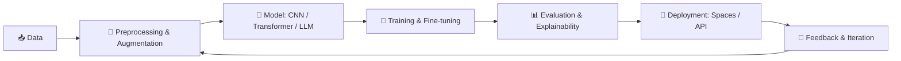
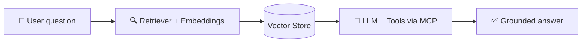

<div align="center">


<br/><br/>


[](https://linkedin.com/in/mohamed-kharrat1)
[](https://huggingface.co/shankos)
[](mailto:mohamed.kharrat@ensi-uma.tn)

</div>

---

## 👨‍💻 About Me

AI Engineer who loves understanding models from the math up, then shipping them as working systems. I enjoy the full cycle: data, architecture, training, evaluation, deployment.

- 🧠 **Deep Learning**: CNN, ResNet, RNN, LSTM, full Transformer architecture (self-attention, multi-head attention, BERT vs GPT)
- 🔁 **Transfer Learning**: fine-tuning pretrained backbones, data augmentation, handling class imbalance and overfitting
- 💬 **LLM Engineering**: RAG pipelines, prompt engineering, embeddings, vector search, LLM APIs
- 🤖 **Agentic AI**: tool-using agents, multi-step workflows, **MCP** (Model Context Protocol), **LangChain**
- 🎛️ **Efficient fine-tuning**: LoRA and QLoRA
- 👁️ **Computer Vision**: classification, object detection and tracking, explainability with Grad-CAM
- 📐 **Math foundations**: linear algebra, optimization, backpropagation, linear programming and duality
- 🎓 Computer Engineering student (AI/ML) at **ENSI**, University of Manouba · 🏆 Member of **ECPC** competitive programming club

---

## ⚡ Snapshot

```python
class MohamedKharrat:
    role      = "AI Engineer"
    location  = "Tunisia 🇹🇳"
    languages = ["Python", "Java", "C/C++", "TypeScript", "JavaScript"]
    core      = ["Deep Learning", "LLMs", "RAG", "Agents", "Computer Vision"]
    stack     = ["PyTorch", "Hugging Face", "LangChain", "MCP", "YOLOv8", "Scikit-learn"]
    mindset   = "Understand the math, then ship the model."
```

---

## 🧰 Tech Arsenal

<div align="center">

**AI / Machine Learning**


**Languages**


**Web (for AI products)**


**Tools & Platforms**


</div>

<details>
<summary><b>🔎 Full AI stack (click to expand)</b></summary>

<br/>

| Area | Tools |
|---|---|
| Deep Learning | PyTorch, CNN / ResNet50, RNN / LSTM, Transformers |
| LLM & Agents | Hugging Face (Transformers, Hub, Spaces), LangChain, Anthropic API (Claude), MCP, RAG, LoRA / QLoRA |
| Computer Vision | YOLOv8, ByteTrack, OpenCV, Grad-CAM |
| Data Science | NumPy, Pandas, Scikit-learn, Matplotlib |
| Demos & Deployment | Hugging Face Spaces, Streamlit, Gradio, FastAPI, Docker |
| Web (AI front-ends & APIs) | React, Next.js, Node.js, Express, TypeScript, Tailwind CSS |
| Workflow | Git, GitHub, GitHub Copilot, VS Code, Google Colab, Jupyter |

</details>

---

## 🏗️ How I Build AI Systems





---

## 🚀 Featured Projects

<table>
<tr>
<td width="33%" valign="top">

### 🩻 Pneumonia Detector
Deep learning model that detects pneumonia from chest X-rays. Deployed live.

- **86.7% accuracy**
- ResNet50 + Transfer Learning
- Solved class imbalance, overfitting and fine-tuning instability
- Gradio demo on Hugging Face Spaces

[🔗 Live demo](https://huggingface.co/shankos) · [💻 Code](https://github.com/mohamedkharrat-eng)

</td>
<td width="33%" valign="top">

### 🛒 Shoplifting Detection
Real-time video analysis that detects and tracks people to flag suspicious behavior.

- YOLOv8 object detection
- ByteTrack multi-object tracking
- Behavior analysis on video streams

[💻 Code](https://github.com/mohamedkharrat-eng)

</td>
<td width="33%" valign="top">

### 📄 Chat with your PDFs
RAG assistant that answers questions grounded in my own documents.

- Document chunking + embeddings
- Vector retrieval
- Claude API for answer generation
- LangChain orchestration

[💻 Code](https://github.com/mohamedkharrat-eng)

</td>
</tr>
</table>

---

## 🧭 AI Skill Map

| Level | Skills |
|---|---|
| ✅ **Core** | CNN, RNN, LSTM, Transformers, Transfer Learning, Data Augmentation, Scikit-learn, PyTorch |
| ✅ **LLM Engineering** | RAG, embeddings, prompt engineering, Hugging Face, LangChain, LLM APIs |
| ✅ **Agentic AI** | Tool use, multi-step agents, MCP servers and clients |
| ✅ **Fine-tuning** | LoRA, QLoRA, parameter-efficient adaptation |
| ✅ **Vision** | YOLOv8, ByteTrack, ResNet, Grad-CAM |
| ✅ **Deployment** | Hugging Face Spaces, Streamlit, Gradio, FastAPI, Docker |
| ✅ **Math** | Linear algebra, optimization, linear programming, duality |

---

## 🤝 Let's Connect

I'm open to AI/ML projects, research discussions, internships and collaborations on LLMs, agents and computer vision.

[](https://linkedin.com/in/mohamed-kharrat1)
[](https://huggingface.co/shankos)
[](mailto:mohamed.kharrat@ensi-uma.tn)

<div align="center">

*"The best way to understand AI is to build it."*


</div>
